<p align="center">
  
</p>

<h1 align="center">Geometry Dash — Dreamcast Port</h1>

<p align="center">
  A Sega Dreamcast port of Geometry Dash, built on <a href="https://www.kallistios.org">KallistiOS</a>.<br>
  Based on the PS2/PSP port (<a href="https://github.com/rLeo2023/geometrydash-psp">rLeo2023/geometrydash-psp</a>),
  itself based on the 3DS port (<a href="https://github.com/AleFunky/gd3ds">AleFunky/gd3ds</a>).
</p>

## Download

Prebuilt images are on the [Releases](../../releases) page:

| File | For |
|------|-----|
| `GD_Dreamcast_GDI.zip` | Real hardware with GDEMU, MODE or USB-GDROM — copy the `GDI` folder to your SD card |
| `GD_Dreamcast_Emulator.zip` | Flycast / Redream — open `gd.cue` |

## Controls

| Button | Action |
|--------|--------|
| A | Jump / confirm |
| B | Back |
| D-Pad | Menu navigation |
| Start | Pause |

## Features

- Native 640x480 rendering on the PowerVR GPU, via a citro2d-compatible shim (`dc/src/c2d_dc.c`)
- Music streaming and sound effects through the AICA (`dc/src/mp3_dc.c`, `dc/src/wav_dc.c`)
- Maple controller input with an emulated touch cursor for menus
- Custom ISO9660 reader (`dc/src/romfs_dc.c`) — the stock KOS driver stalled on this disc layout
- `.dcs` texture atlases with on-demand VRAM paging to fit the Dreamcast's 8 MB of VRAM

## Known limitations

- Progress is **not saved** to the VMU (lost on power off)
- Online levels are disabled
- Some texture pages load on demand, which can cause a brief hitch

## Building

You need a KallistiOS toolchain (`sh-elf-gcc`). See [dc/README.md](dc/README.md) for full
setup and build instructions.

```sh
./dc/tools/build_assets.sh   # convert assets into dc/disc/romfs
./dc/build.sh                # produce gd.elf
./dc/tools/package.sh        # produce gd.iso / gd.cue and the GDI image
```

Songs, levels and sound effects are **not** included in this repository — `build_assets.sh`
extracts them from your own copy of the PS2 port.

## Credits

- [RobTop](https://www.robtopgames.com) — Geometry Dash
- [AleFunky](https://github.com/AleFunky/gd3ds) — original 3DS port this is based on
- [rLeo2023](https://github.com/rLeo2023/geometrydash-psp) — PSP/PS2 port used as the direct base
- [KallistiOS](https://github.com/KallistiOS/KallistiOS) — Dreamcast SDK

*Unofficial fan port. Geometry Dash is property of RobTop Games.*
